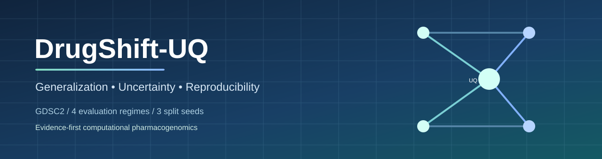
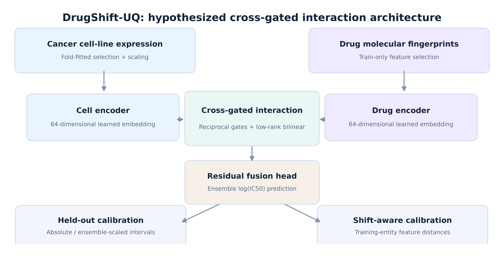
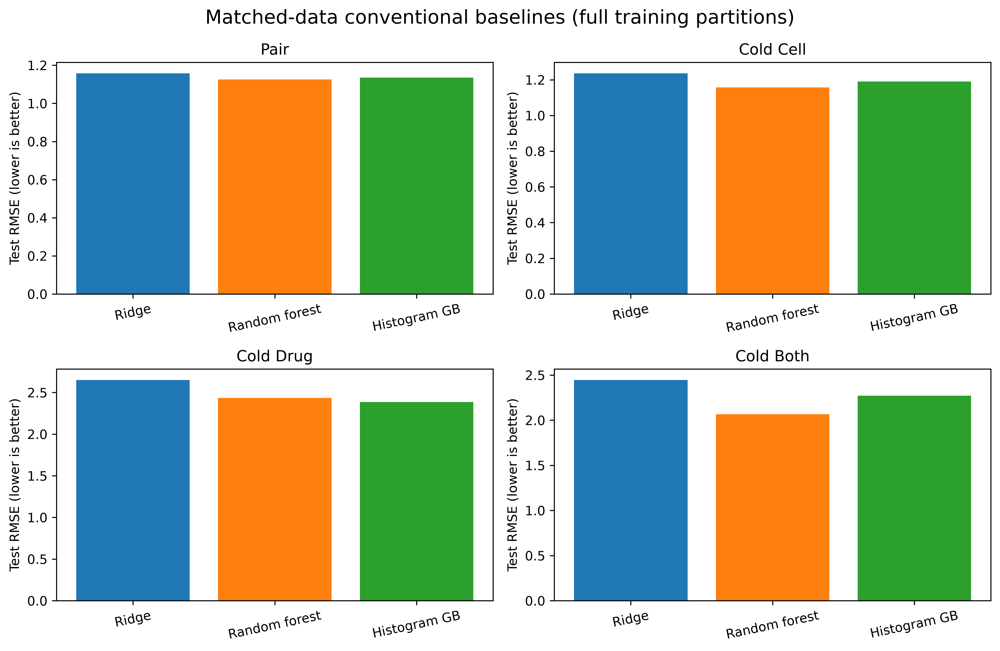
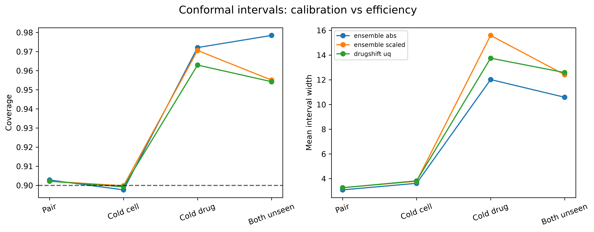
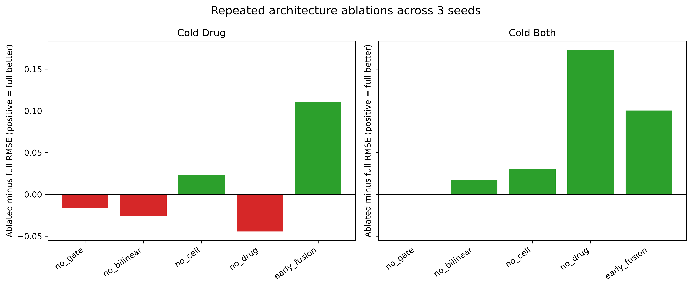

<div align="center">
  

  # DrugShift-UQ

  **Cross-gated drug response prediction · cold-start generalization · uncertainty reliability**

  
  
  
  
  

  [Overview](#research-overview) • [Findings](#experimental-evidence) • [Reproduce](#reproduce-the-experiments) • [Ablations](#architecture-and-ablations) • [Citation](#citation-and-attribution)
</div>

> [!IMPORTANT]
> **Evidence, not a diagnostic product.** Predictions concern *in-vitro cancer cell-line sensitivity*, not patient outcomes. Results include negative findings. No clinical use is intended.

## Research overview

DrugShift-UQ evaluates how drug-sensitivity models fare when drugs, cell lines, or **both** were absent from training. Its dual-encoder neural model combines gene expression and 512-bit drug fingerprints with reciprocal gating and low-rank interactions, then compares **three interval-calibration strategies** on separate calibration data.

The contribution is an **auditable comparative study**, not proof that gating or feature-distance calibration are novel in isolation or universally better. The underlying dataset is the [DrEval GDSC2 v47 archive](https://zenodo.org/records/21807175), with dataset processing pinned by its checksum.

<p align="center"></p>

### Four leakage-audited evaluation regimes

| Protocol | Which entities may be unseen at test time? | Purpose |
|---|---|---|
| **Held-out pairs** | New pair, familiar entities | Interpolation across measured entities |
| **Cold cell lines** | Entirely unseen cell lines | Extrapolation to other cellular contexts |
| **Cold drugs** | Entirely unseen compounds | Extrapolation to other compounds |
| **Double-cold** | Both drugs **and** cell lines unseen | Stricter dual-entity generalization |

> Double-cold retains only diagonal train/validation/calibration/test entity quadrants, excluding cross-quadrant interactions; it is therefore a smaller, different test population. See [split protocol](docs/RESEARCH_PROTOCOL.md).

## Experimental evidence

**Curated evaluation cohort:** 75,201 aligned response pairs, 941 cell lines, 234 drugs. Four gene-expression duplicate ID groups were reconciled; 53 drugs with unavailable fingerprint bits were excluded. Each main regime uses three split seeds (`42, 123, 2026`).

### Test RMSE (mean ± SD, 3 seeds; lower is better)

| Evaluation | Cross-gated ensemble | Random Forest | Hist. gradient boost | Ridge |
|:--|--:|--:|--:|--:|
| Held-out pairs | **0.956 ± 0.015** | 1.126 ± 0.011 | 1.135 ± 0.016 | 1.158 ± 0.015 |
| Cold cell lines | **1.134 ± 0.013** | 1.157 ± 0.021 | 1.191 ± 0.019 | 1.236 ± 0.022 |
| Cold drugs | 2.414 ± 0.547 | 2.435 ± 0.520 | **2.387 ± 0.458** | 2.650 ± 0.264 |
| Double-cold | 2.148 ± 0.307 | **2.067 ± 0.396** | 2.272 ± 0.287 | 2.446 ± 0.267 |

Conventional baselines in this table were **refitted on full, matched training partitions** in the supplementary analysis. The ensemble is best on held-out pairs and cold cell lines, **not** on unseen-drug or double-cold tasks. The uncertainty layer changes interval estimates rather than the ensemble's point-prediction RMSE.

<p align="center"></p>

### Uncertainty: reliability matters more than width alone

At nominal 90% coverage, feature-distance-scaled intervals had **worse mean interval scores** than simple absolute-residual conformal intervals in all four regimes; under cold drugs, they widened intervals without improving coverage.

<p align="center"></p>

| Cold shift | Absolute-residual interval score | DrugShift-UQ interval score |
|:--|--:|--:|
| Cold cell lines | **5.254** | 5.355 |
| Cold drugs | **12.447** | 14.473 |
| Double-cold | **10.935** | 13.435 |

Conformal marginal coverage guarantees require exchangeability and are not automatically preserved under these shifts.

## Architecture and ablations

The pipeline compares the cross-gated model with ablations for `no_gate`, `no_bilinear`, `no_cell`, `no_drug`, and `early_fusion`. Original single-seed cold ablations are augmented with **three-seed** evaluations on the two cold-drug regimes.

<p align="center"></p>

- Reciprocal gating offers **no consistent gain** under the measured cold splits.
- Removing drug features can help some unseen-drug seeds yet hurts double-cold generalization.
- An early-fusion replacement has higher *average* RMSE but large between-seed variability.

Read [scientific limitations](docs/SCIENTIFIC_LIMITATIONS.md) before interpreting this as evidence of component-level superiority.

## Reproduce the experiments

### Windows 11 — one click, checkpointed and resumable

1. Download or clone this repository into a normal writable folder.
2. Double-click **`START_RESEARCH.bat`** for a fresh complete main run. It installs an isolated environment and obtains the pinned dataset on the first run.
3. If interrupted, click **`RESUME_RESEARCH.bat`**. Completed jobs are skipped and interrupted neural members resume from epoch checkpoints.
4. When the original run finishes, double-click **`supplement/RUN_STRENGTHENING_ONCE.bat`** to reproduce matched full-data baselines and repeated ablations. This stage also skips completed fits.

**Do not rerun experiments to read the published figures or tables.** Aggregate results and plot images already live in [`evidence/`](evidence/). The original output and supplementary analysis can also be obtained by running the code from scratch.

<details><summary><b>Python / terminal alternative</b></summary>

```powershell
py -3.12 -m venv .venv
.\.venv\Scripts\python.exe -m pip install -e .
.\.venv\Scripts\python.exe -m pytest -q
.\.venv\Scripts\python.exe -m drugshift.pipeline --root .
.\.venv\Scripts\python.exe supplement\strengthen.py --project . --mode all
```

> On a CPU-only install, baseline fits and neural models can take hours. An RTX GPU will not be used unless PyTorch with CUDA and compatible device selection are configured explicitly.
</details>

### Provenance and checkpoints

- `config.json` — the original experimental settings, unchanged.
- `src/drugshift/` — **SHA256-exact code** matching the recorded original experiment manifest.
- `evidence/run_manifest.json` — original code/data hash manifest and run ID.
- `evidence/strengthening_manifest.json` — supplementary evidence manifest.
- `results/runs/` — generated checkpointed jobs and prediction files (**ignored by Git**).
- `evidence/tables/` — publication-scale aggregate CSV tables (no raw assay rows).
- `logs/pipeline.log` — append-only local execution log (**ignored by Git**).

**The repository excludes the original ~522 MB dataset archive, processed features, bulk per-pair predictions and large model checkpoints.** Dataset rights and upstream provenance remain with the data creators. See [data provenance](docs/DATA_PROVENANCE.md).

## Project layout

```text
DrugShift-UQ/
├── assets/                  # repository banner / architecture diagram
├── evidence/                # aggregate tables, figures & checked manifests
│   ├── figures/
│   └── tables/
├── src/drugshift/            # executable models, loaders, splits & reports
├── supplement/              # full-data matched baselines & repeated ablations
├── tests/                   # data, leakage, checkpoint and loader regression tests
├── docs/                    # protocol, limitations, source & GitHub instructions
├── .github/workflows/       # synthetic-data CI checks
├── config.json              # immutable experimental configuration
├── START_RESEARCH.bat       # fresh run, or skip already-completed jobs
├── RESUME_RESEARCH.bat      # reuse checkpoints after interruptions
└── pyproject.toml
```

## Citation and attribution

If you build on this work, cite the manuscript once it is publicly available. **Do not cite a nonexistent DOI.** Until then, see [`CITATION.cff`](CITATION.cff) for the work's title and contributors.

**Source dataset:** Bernett, Iversen and Picciani, [*Dataset for drevalpy*, v47](https://doi.org/10.5281/zenodo.21807175) (2026).

**Key related work:** [DrEval benchmark](https://doi.org/10.1038/s41467-026-72903-w) · [MOLI](https://doi.org/10.1093/bioinformatics/btz318) · [Conformal prediction overview](https://doi.org/10.1561/2200000101).

**Research authors:** Jasmine Kaur, Alok Raj (corresponding), Gaurav Gupta — Yogananda School of AI, Computers and Data Sciences, Shoolini University, India.

**Code license:** [MIT](LICENSE). **Dataset license:** governed separately by the external provider; not redistributed here. AI-assisted implementation/drafting is disclosed in the associated manuscript; all scientific claims remain subject to independent validation.

---
<div align="center"><sub>Experimental methodology • transparent ablations • honest uncertainty • reproducible computational work</sub></div>
